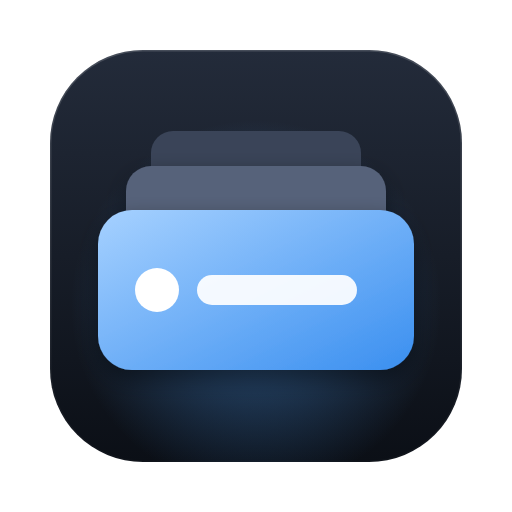

<p align="center"></p>
<h1 align="center">On Deck</h1>
<p align="center"><b>Все сессии Claude Code — под рукой.</b><br>All your Claude Code sessions. On deck.</p>
<p align="center"><a href="https://github.com/Y0LAREN/ondeck-releases/releases/latest"><b>⬇️ Скачать последнюю версию</b></a> · Windows и macOS · бесплатно</p>

On Deck (раньше назывался Claude Hub) — настольное приложение, которое показывает все запущенные сессии Claude Code в одном окне: какая сессия
работает, какая ждёт ответа, сколько занято контекста, и присылает уведомления.

Здесь лежат только установщики и файлы обновлений, исходного кода нет. Последняя версия — на странице
**[Releases → Latest](https://github.com/Y0LAREN/ondeck-releases/releases/latest)**.

> Бета. Если что-то не работает, нажмите в приложении значок жука (вверху справа) и отправьте отчёт,
> он сразу придёт разработчику. Идеи и пожелания — кнопка «Обратная связь» рядом.

## Требования

- Windows 10 или 11, 64-bit, или macOS на Apple Silicon (M1 и новее)
- Установленный [Claude Code](https://docs.claude.com/en/docs/claude-code/setup)
- Права администратора не нужны, Git for Windows не обязателен

## Установка через Claude Code (проще всего)

Откройте Claude Code в любой папке и вставьте этот промпт целиком:

````text
Установи мне приложение On Deck для Windows из публичного репозитория
https://github.com/Y0LAREN/ondeck-releases. Действуй по шагам, используй PowerShell.

1. Проверь, что система — Windows 10/11 x64. Если нет — остановись и скажи мне.
2. Получи последний релиз через API:
   https://api.github.com/repos/Y0LAREN/ondeck-releases/releases/latest
   Возьми из assets единственный файл, оканчивающийся на ".exe" (не ".blockmap" и не ".yml").
   Скачай его в $env:TEMP через Invoke-WebRequest. Покажи мне имя файла, версию и размер.
3. Если сейчас запущен On Deck или старая версия Claude Hub (процессы "On Deck" или "Claude Hub"), попроси меня закрыть их и подожди.
4. Запусти установщик в тихом режиме и дождись завершения:
   Start-Process -FilePath <путь к .exe> -ArgumentList '/S' -Wait
   Установка идёт в профиль пользователя, права администратора не нужны.
5. Найди установленное приложение: обычно это
   "$env:LOCALAPPDATA\Programs\on-deck\On Deck.exe".
   Если там нет — поищи "On Deck.exe" в $env:LOCALAPPDATA\Programs. Запусти его.
6. Удали скачанный установщик из $env:TEMP.
7. НЕ редактируй ~/.claude/settings.json сам. Подключение к Claude Code делает само приложение,
   после того как я посмотрю, что оно изменит. Объясни мне коротко, что сделать:
   - в окне On Deck нажать «Review setup», посмотреть список изменений и нажать «Install»;
   - перезапустить уже открытые сессии Claude Code, чтобы они начали показывать живой статус;
   - в Settings нажать «Send test notification» и, если уведомление не появилось, включить уведомления
     для On Deck в Параметры Windows → Система → Уведомления.
8. Когда я скажу, что нажал Install, проверь, что в %USERPROFILE%\.claude\settings.json появились хуки,
   ссылающиеся на hook.ps1 из %APPDATA%\on-deck, и что statusLine указывает на statusline.ps1.
   Ничего не меняй, только сообщи результат.

Если на каком-то шаге ошибка — покажи мне текст ошибки и не пытайся обходить защиту Windows.
В конце напомни: при проблемах в On Deck есть кнопка с жуком «Found a bug? Send us a report».
````

## Установка вручную (Windows)

1. Откройте **[последний релиз](https://github.com/Y0LAREN/ondeck-releases/releases/latest)** и скачайте файл
   `On-Deck-Setup-<версия>.exe`.
2. Запустите его. Установщик не подписан, поэтому Windows покажет «Система Windows защитила ваш компьютер» —
   нажмите **Подробнее → Выполнить в любом случае**.
3. Пройдите установку и запустите On Deck.
4. В окне приложения нажмите **Review setup**, посмотрите, что изменится в настройках Claude Code, и нажмите
   **Install**. Перед изменением приложение делает резервную копию `settings.json`.
5. Перезапустите открытые сессии Claude Code — после этого они начнут показывать живой статус.
6. В **Settings** нажмите **Send test notification**. Если уведомление не появилось, включите уведомления для
   On Deck: Параметры Windows → Система → Уведомления.

## Установка на Mac

1. Откройте **[последний релиз](https://github.com/Y0LAREN/ondeck-releases/releases/latest)** и скачайте
   `On-Deck-<версия>-arm64.dmg`.
2. Откройте его и перетащите **On Deck** в «Программы». Запускайте из «Программ», не из окна образа.
3. Сборка пока не заверена Apple, поэтому при первом запуске macOS скажет, что не может проверить приложение. Нажмите
   **Готово**, откройте **Системные настройки → Конфиденциальность и безопасность**, внизу у сообщения про On Deck нажмите
   **Всё равно открыть** и подтвердите паролем. Это нужно один раз.
4. Дальше так же, как на Windows: **Review setup** → **Install**, перезапустить открытые сессии Claude Code и разрешить
   уведомления (Системные настройки → Уведомления → On Deck).

## Обновления

Если у вас стоит Claude Hub 0.1.x, он сам предложит обновиться до On Deck: настройки перенесутся, а приложение один раз попросит обновить подключение к Claude Code (кнопка «Проверить обновление» / «Review update»).


Начиная с 0.3.0 обновления ставятся из приложения и на Windows, и на Mac. На Mac с версии 0.2.0 и раньше нужно один раз
поставить 0.3.0 вручную (см. выше).

Приложение само проверяет новые версии (через 15 секунд после запуска и раз в 4 часа). Когда выходит обновление,
вверху появляется кнопка **Update x.y.z**: нажмите её, затем **Restart and install**. Сессии Claude Code при этом
продолжают работать.

## Нашли ошибку?

Нажмите значок жука вверху окна (или Settings → Support → **Found a bug? Send a report…**), опишите, что случилось,
и нажмите **Send**. Вместе с описанием уйдут версии приложения и системы, состояние подключения к Claude Code и лог
приложения; скриншот окна — по желанию. Перед отправкой можно посмотреть весь текст. Промпты, названия сессий и пути
к проектам в отчёт не попадают. Если отправка не удалась — **Save to file…** и пришлите файл разработчику.

## Что собирает On Deck

On Deck работает локально: ваши сессии, запросы и код остаются на вашем компьютере.

По умолчанию приложение отправляет на сервер разработчика **анонимную статистику использования**, чтобы было видно, чем
пользуются и что ломается. Сторонним сервисам ничего не передаётся. При первом запуске вы увидите уведомление, а
выключить отправку можно в любой момент: Настройки → Конфиденциальность. Когда она выключена, ничего не отправляется.

**Отправляется:** случайный идентификатор установки (он ни с кем не связан), версия приложения, система и её версия,
архитектура процессора, язык интерфейса; факты установки, запуска и обновления; раз в сутки — сколько было сессий,
максимум одновременно и количество ответов на вопросы, показанных уведомлений и открытых из On Deck терминалов;
получилось ли подключить Claude Code (короткий код ошибки при неудаче); первые события (первая сессия, первый ответ на
вопрос, первое открытие терминала); какие функции вы пробовали и какие настройки меняли (только включено/выключено или
язык); технические сбои в виде коротких кодов. IP-адреса на сервере не сохраняются.

**Никогда не отправляется:** запросы, названия сессий, пути проектов, имена файлов, код, названия веток, имена
пользователей и любой введённый вами текст.

Отчёты об ошибках, отзывы и необязательный опрос уходят только по вашей кнопке «Отправить», и перед отправкой видно, что
в них входит; они работают и при выключенной статистике. Только Windows: после удаления может открыться страница с
вопросом, почему вы ушли; она связана с вашей установкой, только если статистика была включена.

<details>
<summary>What On Deck collects (English)</summary>

On Deck is local-first: your sessions, prompts and code stay on your machine. By default it sends **anonymous usage
counts** to the developer's own server (no third parties) to see what is used and what breaks. You see a notice on
first launch and can turn it off any time in Settings → Privacy; when off, nothing is sent.

**Sent:** a random install id, app version, OS and version, CPU architecture, UI language; installed / started /
updated; once a day, how many sessions you had, the most at once, and counts of questions answered, notifications shown
and terminals opened; whether connecting Claude Code worked (short error code); first-time milestones; which features
you tried and which settings you changed (on/off or language only); technical failures as short codes. IP addresses are
not stored.

**Never sent:** prompts, session names, project paths, file names, code, branch names, user names or any text you type.

Bug reports, feedback and the optional survey are sent only when you click Send, and show their content first.
</details>

## Удаление

Windows: Параметры → Приложения → On Deck → Удалить. Mac: удалите On Deck из «Программ». Перед этим в Settings приложения можно нажать
**Uninstall** у интеграции, чтобы убрать хуки из настроек Claude Code.
